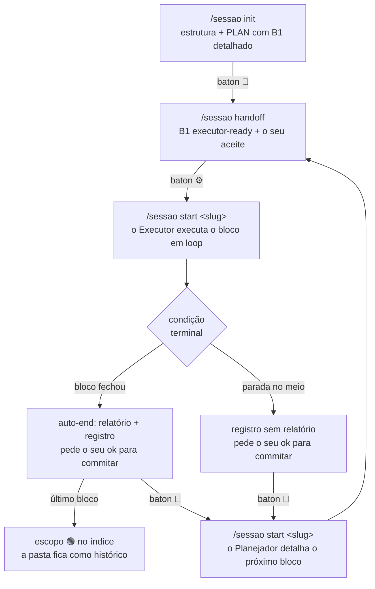
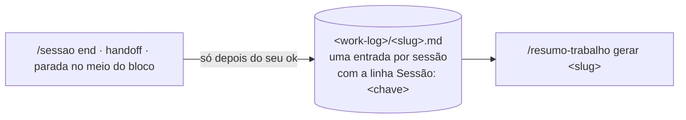

# claude-skills

Duas skills para agentes de código (**Claude Code** e **Codex**) que trabalham juntas para tocar
projetos longos com I.A. sem perder o fio entre sessões — e sem perder o registro do que foi feito:

| Skill | Para que serve | Como é acionada |
|---|---|---|
| [`sessao`](sessao/) | **Controle de Sessões.** Organiza um projeto de escopo definido em blocos, com um `PLAN.md` por escopo como fonte única de verdade, um protocolo Planejador/Executor e um portão executável que impede fechar a sessão com registro inconsistente. | **Só explícita:** `/sessao <sub>` (Claude Code), `$sessao` ou `@sessao` (Codex). |
| [`resumo-trabalho`](resumo-trabalho/) | **Apontamentos.** Mantém um log de trabalho por card do GitLab, fora de qualquer repo, e gera o resumo no modelo "Apontamentos" (markdown GitLab, pt-BR), escrito para ser lido pela chefia. | Por comando (`/resumo-trabalho <sub>`) ou por pedido em linguagem natural ("resumo do card X", "apontamentos"). |

Elas se encontram num ponto só: **o slug de um escopo do `sessao` é o label de um log do
`resumo-trabalho`**. Toda sessão que termina grava a sua entrada nesse log, e o resumo do dia sai
completo com um comando.

---

## Sumário

- [Instalação](#instalação)
- [Configuração](#configuração)
- [Skill `sessao`](#skill-sessao)
- [Skill `resumo-trabalho`](#skill-resumo-trabalho)
- [Como as duas se integram](#como-as-duas-se-integram)
- [Estrutura do repositório](#estrutura-do-repositório)
- [Manutenção](#manutenção)
- [Versionamento](#versionamento)

---

## Instalação

A raiz deste repositório **é** o diretório de skills do Claude Code. Cada skill mora em um lugar só; as
outras ferramentas enxergam a mesma cópia por symlink.

```bash
# Claude Code — o repositório é o próprio diretório de skills
git clone git@github.com:tgc77/claude-skills.git ~/.claude/skills

# Codex — symlinks para a mesma cópia (nada de copiar arquivos)
mkdir -p ~/.codex/skills
ln -s ~/.claude/skills/sessao          ~/.codex/skills/sessao
ln -s ~/.claude/skills/resumo-trabalho ~/.codex/skills/resumo-trabalho
```

- Uma skill nova só aparece para o Claude Code numa **sessão nova**, não na sessão em que foi instalada.
- O Codex também reconhece `.agents/skills/`. Um symlink `~/.agents/skills → ~/.claude/skills` funciona,
  e o lançador do portão procura em `<repo>/.agents/skills/sessao` quando a skill está vendorizada no
  próprio projeto.
- **Leve `sessao/agents/openai.yaml` junto** se mover, clonar ou empacotar a skill `sessao`: é ele que
  impede a invocação implícita no Codex (`allow_implicit_invocation: false`). Sem ele sobra só o texto
  do `SKILL.md`, e texto sozinho não impede nada.
- `synced/` está no `.gitignore`: é o cache em que o Claude Code baixa as skills da conta
  (`anthropic-skills:*`), não conteúdo deste repositório.

**Requisitos dos scripts:** `bash`, `git`, `grep -E`, `sed` e `awk` (o `mawk` basta) para o portão;
`python3` e GNU `sed`/`date` também para o autoteste.

## Configuração

Nenhuma variável é obrigatória; todas têm um padrão.

| Variável | Padrão | Para que serve |
|---|---|---|
| `SESSAO_WORKLOG_DIR` | `~/.claude/work-log` | Diretório do log de apontamentos, **compartilhado pelas duas skills**. Um arquivo por label/slug. |
| `SESSAO_SKILL_DIR` | — | Onde o lançador do portão procura a skill `sessao` antes dos caminhos padrão (CI, instalação fora do padrão). |
| `CLAUDE_CONFIG_DIR` | `~/.claude` | Respeitada pelo lançador ao procurar `skills/sessao`. |
| `CODEX_HOME` | `~/.codex` | Idem, para a instalação do Codex. |

O log fica no diretório do Claude Code só por histórico: é um endereço de arquivo, e qualquer
ferramenta lê e escreve nele.

---

## Skill `sessao`

> Referência: [`sessao/SKILL.md`](sessao/SKILL.md) (o roteador e as regras invioláveis),
> [`sessao/subcomandos/`](sessao/subcomandos/) e [`sessao/referencia/`](sessao/referencia/) — juntos, o
> protocolo e a **fonte canônica**. [`sessao/HELP.md`](sessao/HELP.md) é o índice que `/sessao help`
> mostra; [`sessao/HISTORICO.md`](sessao/HISTORICO.md) guarda o porquê de cada regra.

### A ideia

Cada sessão com um agente começa com o contexto zerado. O `sessao` põe a continuidade **nos
arquivos**, não na conversa, com uma regra só: **cada fato mora em um arquivo; o resto aponta, nunca
copia.** O plano se detalha em *rolling-wave*: o bloco ativo em alta resolução, os distantes em uma
linha de rascunho. E o trabalho é dividido entre dois papéis:

- 🧠 **Planejador** (modelo forte) — na fronteira de cada bloco, detalha o próximo até ficar
  "executor-ready", resolve as decisões de design, **mede** cada critério de aceite e escreve o
  contrato de execução. Não implementa.
- ⚙️ **Executor** (modelo barato) — executa o bloco à risca, em loop, até uma condição terminal de uma
  lista fechada. Não toma decisão de design: se a realidade divergir do plano, **para e devolve** ao
  Planejador.

Quem diz qual papel a próxima sessão assume é o **baton** — a linha `🎬 Próximo:` do cabeçalho do
PLAN. O `start` lê essa linha e age sem perguntar.

### O que ela instala num projeto

```
<repo>/
├── CLAUDE.md                  ← uma linha: `@AGENTS.md` (o Claude Code não lê AGENTS.md)
├── AGENTS.md                  ← índice de escopos + regras do projeto + bloco gerenciado (lido pelo Codex e, via import, pelo Claude)
├── scripts/
│   └── conferencia_saida.sh   ← LANÇADOR do portão: acha a skill e roda o portão dela
└── docs/sessoes/
    ├── template-relatorio.md  ← um por repo, reusado por todo escopo
    └── <slug>/                ← um escopo = uma pasta
        ├── PLAN.md            ← fonte única de verdade daquele escopo
        └── RELATORIO_<bloco>_<AAAA-MM-DD>.md
```

**O protocolo mora na skill; o plano é por escopo.** O `AGENTS.md` do projeto guarda só o índice, as
regras do próprio projeto e um **bloco gerenciado** curto (entre `<!-- sessao:inicio` e
`<!-- sessao:fim -->`), que declara a ativação explícita e que o `/sessao update` mantém igual ao
template — cópia de protocolo congela na versão do dia em que foi feita. Uma frente de trabalho nova é
só uma pasta nova com um `PLAN.md` e uma linha no índice. ⛔ **Nunca** use `AGENTS.override.md`: no
Codex ele *substitui* o `AGENTS.md` em vez de somar.

O **slug** é o identificador único do escopo: nome da pasta, argumento dos comandos e label do
apontamento. Sem apelidos, em kebab-case, e **único entre projetos** (o log é global): prefira
`aca-amortizacao` a `amortizacao`.

### Subcomandos

Sintaxe: `/sessao <subcomando> [<slug>] [<texto livre>]`. O escopo é **argumento, não estado**, e nunca
é deduzido: o `start` exige o slug escrito; `handoff` e `end` operam o escopo do `start` da sessão ou o
slug passado; sem slug, o agente lista os escopos e pergunta.

| Subcomando | O que faz | Altera o repo? |
|---|---|---|
| `escopos [<slug>]` | Lista os escopos (slug, descrição, estado, branch, bloco ativo, baton, última atualização) e avisa inconsistências de identidade. | Não |
| `help` | Mostra o [`HELP.md`](sessao/HELP.md). | Não |
| `init` | Abre um escopo: instala o sistema num repo virgem, ou só cria a pasta do escopo novo num repo já instalado. Levanta os dados **com você**, confirma a estrutura antes de criar e commita só com o seu ok. | Sim |
| `start <slug> [nota]` | Início de sessão: lê o estado do escopo pelo portão (`--estado`, em JSON) e o bloco ativo, confere se o baton não está podre e assume o papel que ele manda. A nota pode pedir só um briefing ("onde paramos?") ou impor diretivas ("só as tarefas de código, sem commit"). | Conforme o papel |
| `handoff` | Planejador → Executor: deixa o bloco executor-ready, mede os critérios, mostra o plano e, com o seu **aceite**, grava baton, apontamento, portão e commit. | Sim |
| `end` | Fim de sessão (ver abaixo). O Executor o dispara sozinho quando o bloco fecha ou quando para no meio dele. | Sim |
| `update` | Põe o projeto em dia com a skill: sincroniza o bloco gerenciado do `AGENTS.md` (`scripts/bloco_agents.sh`), troca a cópia antiga do portão pelo lançador e confere o `CLAUDE.md`. | Sim |

### Ciclo de vida



### Como uma sessão fecha

O ritual de fim tem **duas metades**: o **relatório** só sai quando o bloco fecha (ou quando você pede);
o **registro da sessão** — PLAN atualizado in-place, uma linha nova no registro de sessões (§8),
baton — sai em **toda** sessão que termina, inclusive quando o Executor para no meio de um bloco.

A validação do usuário é o eixo, nesta ordem:

1. Preparar tudo no working tree (PLAN, baton, §8, relatório se houver).
2. Apresentar e **pedir validação**. Sem o "ok", **para**: nada de commit, nada de log.
3. Com o "ok": gravar o **apontamento** no log (ver [integração](#como-as-duas-se-integram)).
4. Rodar o **portão**.
5. **Commitar** só o que é daquele escopo e daquela sessão. `push` é pedido à parte — inclusive para
   deploy.

O log vem depois do aval porque é append-only e fica fora do repo: um apontamento gravado sobre
trabalho que você rejeitou vira histórico falso que nenhum `git reset` desfaz.

### O portão (`scripts/conferencia_saida.sh`)

As regras de fechamento já existiam em prosa e falharam mesmo assim, em sessões que relataram tudo com
honestidade: uma checklist que o próprio agente declara ter cumprido mede a intenção dele, não o
arquivo. O portão mede o arquivo, e **vermelho é PARADA**, não ressalva no relatório.

```bash
scripts/conferencia_saida.sh <slug> <commit em que a sessão começou>   # fechamento: itens ①-⑥
scripts/conferencia_saida.sh <slug> --inicio                           # início: o baton está coerente?
scripts/conferencia_saida.sh <slug> --estado                           # o --inicio + o estado do escopo em JSON
```

| Item | Reprova (exit 1) quando |
|---|---|
| ① | a linha `🎬 Próximo` falta ou está duplicada |
| ② | o parágrafo do baton está **intacto** desde o início da sessão — o baton foi narrado, não passado |
| ③ | o baton manda executar uma tarefa já `[x]` (baton podre) |
| ④ | o registro de sessões (§8) não ganhou linha nova |
| ⑤ | alguma linha nova do §8 não tem a **sua** chave `**Sessão:**` no log de apontamento |
| ⑥ | a sessão escreveu contrato de bloco e passou o baton para ⚙️ **sem** uma linha `**Aceite:** <quem>, <data> (bloco <id>)` nova |

Outros nove itens da Conferência de saída seguem na mão (critérios de aceite medidos, documento de
interface atualizado, nenhuma decisão pendente selada por fora etc.) — ver
[`sessao/referencia/conferencia.md`](sessao/referencia/conferencia.md).

O `--estado` devolve no stdout, em JSON, o que o `start` e o `escopos` precisam — PLAN, branch, bloco
ativo, baton (papel, ponto de entrada, coerência com os checkboxes), próxima tarefa aberta, gates 🔁,
blockers e se o log de apontamento existe —, para o modelo não ter de interpretar o PLAN sozinho. Sai
com exit 1 se o baton estiver podre, como o `--inicio`.

O projeto recebe um **lançador**, não uma cópia do portão: ele procura a skill em `$SESSAO_SKILL_DIR`
→ `~/.claude/skills/sessao` → `~/.codex/skills/sessao` → `<repo>/.agents/skills/sessao`. Assim toda
correção do portão chega aos projetos já instalados. Se não achar a skill, sai com **exit 2**, nunca 0:
portão que não rodou não pode parecer portão que passou.

---

## Skill `resumo-trabalho`

> Referência completa: [`resumo-trabalho/SKILL.md`](resumo-trabalho/SKILL.md); modelo do resumo em
> [`resumo-trabalho/templates/template-apontamentos.md`](resumo-trabalho/templates/template-apontamentos.md).

### A ideia

O trabalho é entregue **por card do GitLab**, e um card pode levar vários dias e tocar vários repos. Por
isso o log é **um arquivo por label** (card), global e fora de qualquer repositório —
`<work-log>/<label>.md` — e append-only. O resumo é gerado a partir dele, no modelo "Apontamentos",
pronto para colar no card.

### Subcomandos

| Comando | Efeito |
|---|---|
| `label <card>` | Define o label ativo **desta conversa**. |
| `registrar [<card>] [texto]` | Acrescenta uma entrada ao log (O que foi feito / Problemas-Correções / Validações / Pendências). Sem card nem label ativo, **pergunta** — nunca inventa. |
| `gerar <card>` | Resumo do card com as entradas de **hoje** — o apontamento diário. |
| `gerar <card> <AAAA-MM-DD>` | O mesmo para uma data específica (retroativo). |
| `gerar <card> completo` | Resumo de todo o histórico do card. |
| `gerar dia [<AAAA-MM-DD>]` | Agregado de todos os cards do dia. ⚠️ **Só com pedido explícito de agregar todos os cards.** |
| `listar` | Lista os labels existentes, com contagem de entradas e datas. |

Linguagem natural equivalente também vale ("vou trabalhar no card X", "anota isso no card X", "resumo
do card X").

**"Resumo do dia" sem card não é `gerar dia`.** O alvo é resolvido nesta ordem: label ativo da conversa
(ou o slug do escopo do `sessao` que a sessão operou) → escopo do repo atual (índice do `AGENTS.md`) →
só então, e com pedido explícito, o agregado. "Hoje" filtra a data **dentro** do card, nunca amplia a
busca. O motivo é concreto: o apontamento é colado num card específico, e misturar labels entrega à
chefia trabalho de outra frente, em outro repo.

### Regras do resumo

- **Leitor não-técnico:** quem lê é a chefia, que conhece o projeto mas não mexe no código. Todo
  detalhe técnico entra **completo** (nomes, números, comandos, causa raiz) **e** precedido de uma
  explicação curta — bloco "🧭 Para entender este apontamento", aposto na 1ª menção e frase de
  propósito abrindo cada subseção. Cortar detalhe para simplificar é tão errado quanto despejar
  jargão cru.
- **Links:** todo documento, página ou relatório publicado no período entra com link clicável, inline
  e numa seção "📎 Documentos e páginas".
- **MR/issue sempre qualificado:** `grupo/projeto!N`, nunca `!N` solto — o card vive em outro
  projeto, e a referência curta apontaria para o repo errado.
- **Sem horário no título de subseção** — a chefia lê por assunto, não por timestamp.
- **Entrega** dentro de um bloco de 4 crases (ou `~~~`), para colar markdown cru no GitLab.

---

## Como as duas se integram



- **O label é o slug.** Não há campo separado, nem apelido: o escopo `deploy-airflow-prod` escreve em
  `<work-log>/deploy-airflow-prod.md`, e o resumo sai com `/resumo-trabalho gerar deploy-airflow-prod`.
- **Uma sessão = uma entrada — o índice é a sessão, não o relatório.** `end`, `handoff` e toda parada
  no meio de bloco gravam a entrada da sessão. Com relatório, ele é a matéria-prima; sem relatório, a
  fonte é a linha do §8 + as decisões + os commits daquela sessão.
- **A chave da sessão sai do arquivo, nunca da memória.** Ela vem da linha da sessão no §8 do PLAN e
  vai na linha `**Sessão:**` logo abaixo do cabeçalho da entrada:

  | Registro de sessões do PLAN | Chave | Exemplo no log |
  |---|---|---|
  | sem coluna de número (template atual): `\| 2026-09-24 \| B5 \| … \|` | `<data>#<k>`, k = posição entre as linhas de mesma data | `**Sessão:** 2026-09-24#2 · B5 (⚙️ Executor)` |
  | com coluna de número (legado): `\| 11 \| 2026-09-04 \| … \|` | o número | `**Sessão:** 11` |

  A chave torna o registro idempotente (rodar o `end` de novo não duplica) e é o que o item ⑤ do
  portão confere, sessão por sessão. Por isso o §8 é append-only: cada sessão acrescenta a sua linha
  no fim.

---

## Estrutura do repositório

```
.
├── README.md                         ← este arquivo
├── scripts/
│   ├── versao.sh                     ← confere VERSION × CHANGELOG × tag e prepara um lançamento
│   └── autoteste_versao.sh           ← testa o versao.sh num repositório descartável
├── sessao/
│   ├── SKILL.md                      ← o roteador: ativação, subcomando → arquivo, regras invioláveis
│   ├── VERSION                       ← a versão atual (SemVer)
│   ├── CHANGELOG.md                  ← o que mudou em cada versão
│   ├── subcomandos/                  ← um arquivo por subcomando, lido sob demanda
│   ├── referencia/                   ← protocolo, conferência de saída, apontamentos, layout, deploy
│   ├── HISTORICO.md                  ← o porquê de cada regra (não é carregado para operar)
│   ├── HELP.md                       ← índice de uso (/sessao help)
│   ├── README.md                     ← resumo da skill
│   ├── agents/openai.yaml            ← bloqueia invocação implícita no Codex
│   ├── scripts/
│   │   ├── conferencia_saida.sh      ← o portão (fechamento, --inicio, --estado)
│   │   ├── conferencia_saida.shim.sh ← o lançador instalado nos projetos
│   │   ├── bloco_agents.sh           ← sincroniza o bloco gerenciado do AGENTS.md (`update`)
│   │   └── autoteste_portao.sh       ← testa portão, --estado e bloco gerenciado contra os templates
│   └── templates/
│       ├── AGENTS.template.md        ← índice + regras do projeto + bloco gerenciado
│       ├── CLAUDE.template.md        ← o `@AGENTS.md`
│       ├── PLAN.template.md          ← o PLAN de um escopo
│       ├── template-relatorio.md     ← gabarito de relatório de bloco
│       └── README.md                 ← o que o `init` copia para o projeto
└── resumo-trabalho/
    ├── SKILL.md
    ├── VERSION
    ├── CHANGELOG.md
    └── templates/template-apontamentos.md
```

## Manutenção

- **A fonte canônica de cada skill é o `SKILL.md` e os arquivos que ele manda ler** (na `sessao`,
  `subcomandos/` e `referencia/`). Cada regra mora em um desses arquivos só; `HELP.md`, templates e
  este README apontam para eles. Se divergirem, a fonte canônica vence — e a divergência é bug a
  corrigir no mesmo commit.
- **Mexeu numa regra? Leia antes o caso que a criou** em `sessao/HISTORICO.md`, e registre lá o novo.
- **Mexeu no portão, no `bloco_agents.sh` ou nos templates? Rode o autoteste** antes de commitar:

  ```bash
  ~/.claude/skills/sessao/scripts/autoteste_portao.sh   # exit 0 = íntegro; exit 1 = regressão
  ```

  Ele monta repositórios descartáveis a partir dos templates, num `HOME` falso, e afirma que cada item
  do portão dispara quando deve e fica verde quando deve, que o `--estado` devolve JSON correto e que o
  bloco gerenciado é sincronizado sem tocar no resto do `AGENTS.md` (40 casos). Existe porque, em
  2026-08-24, o portão e o `PLAN.template.md` falavam dialetos diferentes e o portão aprovava sem
  conferir quase nada — com exit 0.
- **Mudou o bloco gerenciado do `AGENTS.template.md`?** Rode `/sessao update` em cada projeto instalado.
- **Código que parece morto e não é:** o suporte ao layout legado (PLAN na raiz, índice no `CLAUDE.md`,
  registro de sessões numerado) é deliberado — os escopos legados não serão migrados. Está marcado
  como tal nos scripts e coberto pelo autoteste; removê-lo é retirada de suporte, não limpeza.
- **Commits** no padrão `<skill>: <o que mudou e por quê>`, em pt-BR (ex.: `sessao: o ⑤ confere a
  chave de cada sessão nova`). Mudança que atravessa as duas skills ou o repositório: `repo: …`.
  **Todo commit que muda uma skill acrescenta uma linha na seção `## [Não lançado]` do CHANGELOG
  dela** — ver [Versionamento](#versionamento).
- O antigo espelho `~/workspace/playbook-controle-sessoes/` foi **aposentado** em 2026-09-24. Este
  repositório é a única fonte.

## Versionamento

Cada skill tem a sua própria versão, no padrão [SemVer](https://semver.org/lang/pt-BR/)
(`MAJOR.MINOR.PATCH`), porque elas mudam em ritmos diferentes:

| Onde | O quê |
|---|---|
| `<skill>/VERSION` | a versão atual, e nada mais |
| `<skill>/CHANGELOG.md` | o que mudou em cada versão, no formato [Keep a Changelog](https://keepachangelog.com/pt-BR/1.1.0/) |
| tag `<skill>-v<versão>` | o commit que lançou a versão (ex.: `sessao-v3.0.0`) |

**Quando subir cada número.** O critério é o que muda para quem usa a skill:

- **MAJOR** — quebra algo de que os projetos ou o uso já dependem: subcomando que some ou muda a forma
  de chamar; escopo existente que passa a reprovar no portão sem ter mudado; formato incompatível de
  arquivo (`PLAN.md`, work-log, bloco gerenciado, lançador).
- **MINOR** — capacidade nova que não quebra o que existe: subcomando novo, modo novo do portão, item
  do portão que só vale para escopo novo, texto novo no bloco gerenciado. Exigir uma ferramenta nova
  só para usar a capacidade nova também é MINOR.
- **PATCH** — correção sem mudar o contrato, inclusive de um defeito que fazia o portão aprovar o que
  devia reprovar.

Quando a versão pede ação nos projetos (rodar `/sessao update`, instalar uma ferramenta), o CHANGELOG
diz isso numa linha **Ação nos projetos:**, logo abaixo do título da versão.

**No dia a dia,** todo commit que muda uma skill acrescenta a sua linha em `## [Não lançado]`, sob
*Adicionado*, *Modificado*, *Removido* ou *Corrigido*. **Para lançar:**

```bash
scripts/versao.sh lancar sessao minor   # põe "## [3.1.0] - <hoje>" sobre o "Não lançado" e grava o VERSION
git add sessao && git commit -m "release: sessao 3.1.0"
git tag -a sessao-v3.1.0 -m "sessao 3.1.0"
git push origin master sessao-v3.1.0
```

O `lancar` não commita, não cria tag e não faz push: cada um desses passos segue a regra de sempre e
precisa da validação do Tiago. `scripts/versao.sh verificar` confere que VERSION, CHANGELOG e tag
concordam e que nenhuma skill mudou desde a última tag sem entrada no CHANGELOG. Rode antes de cada
push. `scripts/autoteste_versao.sh` testa o próprio verificador.

**Antes de 2026-10-19 não havia número.** A primeira versão numerada da `sessao` é a 3.0.0: o
repositório já a chamava de "controle de sessões v2" desde o primeiro commit, e a reestruturação de
2026-10-19 quebrou o contrato dessa v2. A `resumo-trabalho` começa na 1.0.0. O que veio antes está
resumido no fim de cada CHANGELOG.
